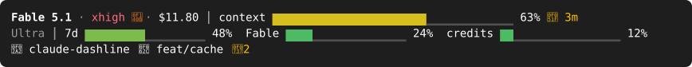
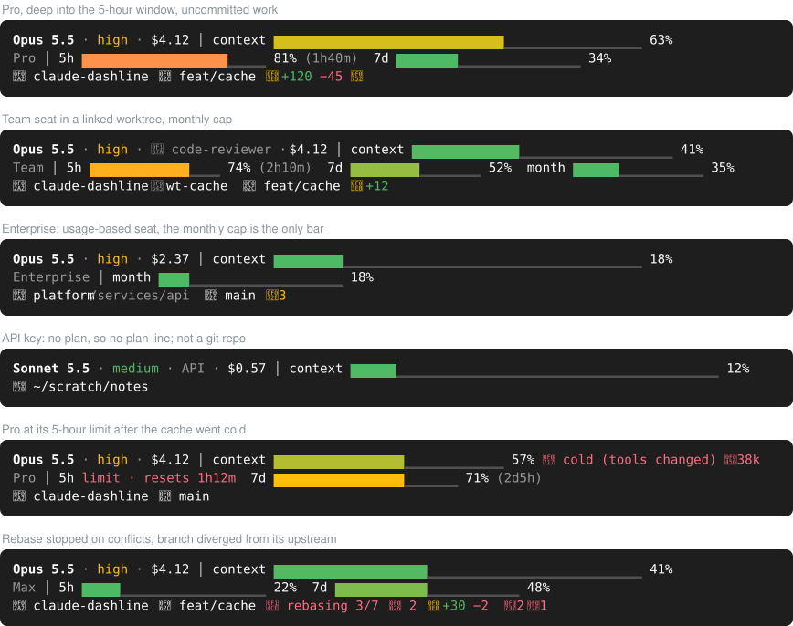

# dashline

One Claude Code statusline for every kind of account: Free, Pro, Max, Ultra, Team,
Enterprise, and API-key, Bedrock, Vertex, Foundry or gateway sessions. It shows the
session (model, effort, cost, context, prompt cache), your plan's usage limits, and
where you are in git, in three lines that fit the terminal's width.



## Install

```
/plugin marketplace add MasonFlint44/claude-toolbox
/plugin install dashline@claude-toolbox
/dashline:install
```

`/dashline:install` checks for Python, copies dashline to
`~/.claude/scripts/statusline/` (or under `$CLAUDE_CONFIG_DIR`), and points the
`statusLine` setting at it. It asks first if you already have a statusline. Then it
shows you dashline in each glyph set so you can pick the one your terminal draws
correctly.

Needs Python 3.9 or newer as `python3`. macOS's command-line tools are enough. git is
optional; without it the third line shows just the folder. Built on Linux with Claude
Code 2.1.318; CI runs the tests on Linux and macOS.

## What it shows



**Line 1, the session:** model, effort level, fast mode, the agent you're talking to,
the session's cost so far (subagents included), and a context-window bar. A prompt cache
about to expire shows a countdown. Once it has gone cold, the line says why (e.g.
"tools changed") and how many tokens the next request will write back into the cache.

**Line 2, the plan:** the plan's name (and days left in a trial), then one bar per
limit: the 5-hour window, the week, a model's weekly limit while you use that model
(e.g. Fable), extra-usage credits once you've used some, and a Team or Enterprise
monthly cap. Bars go from green through gold to coral as they fill. From 70% on, they
show when the window resets. A limit you've hit reads `limit · resets 1h12m`. If the
numbers are more than 5 minutes old because fetching keeps failing, their age follows
(`·12m`). API-key and cloud-provider sessions bill per use and have no plan line; their
label moves up to line 1.

**Line 3, the directory:** the project (with its worktree and the subfolder you're in),
the branch, tag or detached commit, uncommitted lines added and removed, untracked files,
commits ahead of or behind the upstream, a branch that was never pushed or whose upstream
is gone, a rebase, merge, cherry-pick, revert, bisect or `am` in progress, and
conflicts. It also shows where Claude's shell has moved to if that's outside the
project. In terminals that support links, the project name opens its folder, and a
branch pushed to GitHub opens its compare page.

When the terminal is narrow, detail goes in a fixed order. Plan bars move up to line 1
if there's room; otherwise every bar turns into text (`5h 81%`). Line 3 drops line counts
before names. Nothing wraps.

## Glyph sets

| set | needs | looks like |
|---|---|---|
| `nerd` | a [Nerd Font](https://github.com/ryanoasis/nerd-fonts/releases/latest) for icons ("Symbols Only" is enough); Ghostty and WezTerm include one | icons for git, the branch, fast mode, the cache |
| `unicode` (default) | any modern terminal font | `⎇ main  ✎ +12  ⇡2` |
| `ascii` | nothing | `(main)  * +12  >2` |

Switch with `/dashline:install`, or try one with
`python3 ~/.claude/scripts/statusline/statusline.py --preview --glyphs nerd`.

Colors follow your Claude Code theme, including custom themes. `NO_COLOR`
turns them off.

## When something's wrong

Run `/dashline:doctor`. It checks Python, the installed copy, which settings file's
statusline wins, your login, one live usage fetch, the cache, the statusline command
itself, git, the theme and fonts, then explains each problem and fixes what's safe.
Outside Claude Code: `python3 ~/.claude/scripts/statusline/statusline.py --doctor`.

## How plan usage is fetched

Claude Code sends the 5-hour and weekly numbers with each response, but not the
per-model limits, credits or monthly cap. For those, dashline asks the same endpoint
Claude Code's `/usage` screen uses (`api.anthropic.com/api/oauth/usage`) with your
existing Claude login. That token is read from Claude Code's own store: the macOS
Keychain, or `~/.claude/.credentials.json`.

- The request runs in a background process after the statusline has printed, so it
  never slows the statusline.
- At most one request every 3 minutes, shared by all your Claude Code sessions, with
  backoff on errors.
- The token goes only to `api.anthropic.com`. It is never written anywhere, passed on a
  command line or put in an environment variable.
- The answer is cached in `~/.claude/cache/statusline/` (private to you) and tagged
  with your account, so switching logins never shows someone else's numbers.

The endpoint isn't documented. If it changes, the affected bars disappear until
dashline catches up; the rest of the statusline keeps working.

## Uninstall

Remove the `statusLine` entry from `~/.claude/settings.json`, delete
`~/.claude/scripts/statusline/` and `~/.claude/cache/statusline/`, then
`/plugin uninstall dashline@claude-toolbox`.

## Development

```
uv run ruff format && uv run ruff check
uv run pytest
uv run python scripts/preview.py     # redraw docs/*.svg after a visual change
python3 statusline.py --preview      # every built-in scenario in your terminal
```

The design and its reasons are in [docs/PLAN.md](docs/PLAN.md).

## License

MIT. The preview images embed a few icons from
[Symbols Nerd Font](https://github.com/ryanoasis/nerd-fonts) (MIT), drawn from
[Material Design Icons](https://pictogrammers.com/library/mdi/) (Apache 2.0); see
[scripts/assets/](scripts/assets/).
